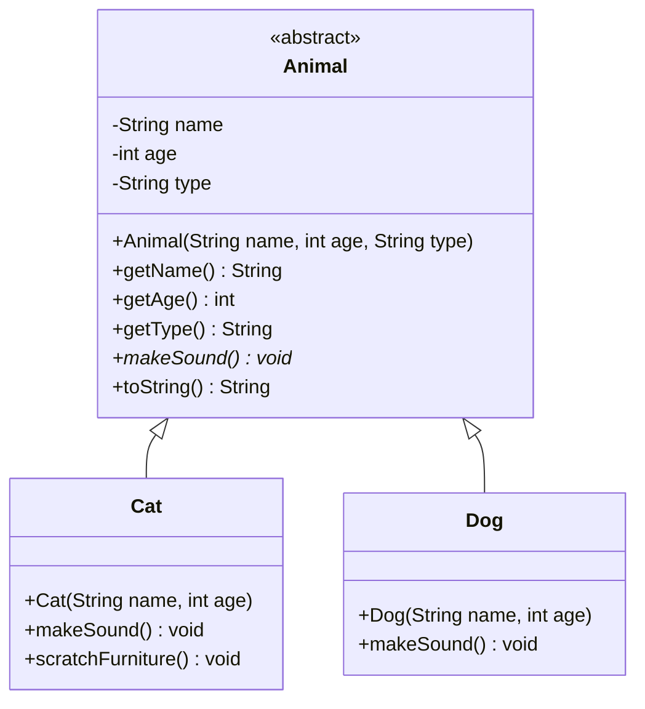

# L19 - [In-class] Polymorphism example

 [CMPINF 0401] Java example from lecture 19 covering **inheritance, abstract classes, and polymorphism**.

## Contents

| File | Content |
| --- | --- |
| `src/Animal.java` | Abstract base class with private fields, a `final` field, getters, an abstract `makeSound()` method, and `toString()` |
| `src/Cat.java` | Subclass that calls `super(...)`, overrides `makeSound()`, and adds its own method (`scratchFurniture()`) |
| `src/Dog.java` | Subclass that overrides `makeSound()` using inherited getters |
| `src/Zoo.java` | `main` that creates animals and calls `makeSound()` on them |

## Class diagram



How to read the diagram:

- **`<<abstract>>`** means `Animal` can't be instantiated (`new Animal(...)` won't compile). It exists only to be extended.
- **Hollow-triangle arrows** (`<|--`) mean `extends`: `Cat` and `Dog` **are** `Animal`s and inherit its fields and methods.
- **`*` after a method** (`makeSound()*`) marks it as abstract. Every concrete subclass must override it. That's why `Cat` and `Dog` each list their own `makeSound()`.
- **`-` / `+`** mean `private` / `public`. The subclasses can't access `name` directly; they call `getName()` instead.
- `type` is also `final` in the code (set once in the constructor). Mermaid has no symbol for that.

## Running

The project uses the default VS Code Java layout: sources are in `src/`, compiled classes are in `bin/`.

**In VS Code:** open the folder with the *Extension Pack for Java* installed, then click **Run** above `main` in `Zoo.java` or `App.java`.

**From the terminal** (Java >= 21):

```bash
javac -d bin src/*.java
java -cp bin Zoo
java -cp bin App
```

## License

[MIT](LICENSE)
